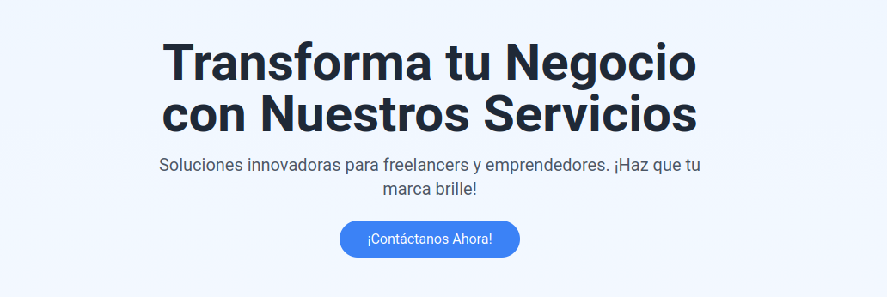
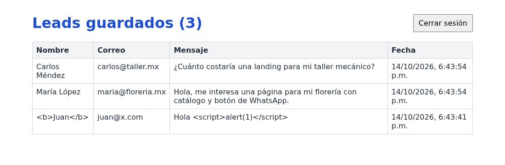

# Landing page con captura de clientes


Landing page responsiva para negocios pequeños con formulario de contacto. Cada mensaje se guarda en MongoDB, puede avisar por correo y se consulta en un panel de administración protegido.

**Demo:** [landing-page-v10.netlify.app](https://landing-page-v10.netlify.app)

> El backend corre en el plan gratuito de Render: si nadie lo ha usado en un rato, el primer envío del formulario puede tardar hasta un minuto.



## Características

- **Formulario con validación** en el navegador y en el servidor: campos obligatorios, formato de correo y longitudes máximas.
- **Leads en MongoDB** con esquema validado por Mongoose.
- **Aviso por correo** opcional con Nodemailer: cada lead llega al correo del negocio con "responder a" del cliente.
- **Panel de administración** con sesión, protegido con contraseña.
- **Protección antispam**: campo trampa invisible para bots y límite de envíos por IP.

## Seguridad: qué corregí y cómo

La primera versión de este proyecto tenía fallas reales. Las encontré al revisarlo y las corregí así:

| Problema en la v1 | Riesgo | Corrección |
| --- | --- | --- |
| El panel mostraba los mensajes sin escapar el HTML | **XSS almacenado**: un mensaje con `<script>` se ejecutaba en el navegador del admin | Todo valor se escapa antes de insertarse en el HTML (`escapeHtml`), más una Content-Security-Policy estricta con Helmet |
| Usuario y contraseña del admin fijos en el código y en el README | Cualquiera podía entrar al panel | Credenciales en variables de entorno; la contraseña se guarda como hash **scrypt** y se compara en tiempo constante |
| El login devolvía la lista en la misma respuesta, sin sesión | Sin cierre de sesión; recargar reenviaba la contraseña | Sesión en cookie firmada con HMAC (`HttpOnly`, `Secure`, `SameSite=Strict`, 2 h) y redirección tras el login |
| `express.static('.')` servía toda la carpeta del proyecto | Exponía `server.js` y, si existía, el `.env` con las credenciales | El backend ya no sirve archivos; el frontend vive en `public/` y Netlify publica solo esa carpeta |
| Sin validación ni límites de tamaño | Documentos enormes o vacíos en la base de datos | Validación en el servidor, `maxlength` en el esquema y límite de 10 KB por petición |
| Límite global de 100 peticiones cada 15 min | Fuerza bruta contra el login | 10 envíos del formulario y 5 intentos fallidos de login por IP cada 15 minutos |

Cada corrección tiene su prueba automatizada en [`test/app.test.js`](test/app.test.js). Así se ve en el panel un intento de XSS guardado: como texto inofensivo.



## Stack

- **Frontend:** HTML, Tailwind CSS, AOS (animaciones) y JavaScript sin frameworks.
- **Backend:** Node.js 20+, Express 5, Mongoose, Helmet, express-rate-limit y Nodemailer.
- **Pruebas:** `node:test` (el runner nativo de Node) con un modelo en memoria; no necesitan MongoDB.
- **CI:** GitHub Actions corre `npm audit` y las pruebas en Node 20 y 22.
- **Despliegue:** frontend en Netlify y backend en Render (`render.yaml`).

## Estructura

```
├── public/              # Frontend estático (lo que publica Netlify)
│   ├── index.html
│   └── script.js
├── src/
│   ├── app.js           # Rutas: /submit, /admin, /api/health
│   ├── seguridad.js     # Escape de HTML, hash scrypt y sesiones firmadas
│   └── validacion.js    # Validación del formulario
├── scripts/
│   └── hash-password.js # Genera ADMIN_PASSWORD_HASH
├── test/app.test.js
├── server.js            # Conexión a MongoDB, correo y arranque
├── render.yaml
└── netlify.toml
```

## Instalación local

```bash
npm install
cp .env.example .env     # y completa los valores
npm run hash-password    # pega el resultado en ADMIN_PASSWORD_HASH
npm run dev              # http://localhost:3000/admin
npm test
```

Para el frontend, sirve la carpeta `public/` (por ejemplo con Live Server en el puerto 5500) y cambia `API_URL` en `public/script.js` a `http://localhost:3000`.

### Variables de entorno

| Variable | Obligatoria | Descripción |
| --- | --- | --- |
| `MONGO_URI` | Sí | Cadena de conexión a MongoDB |
| `ALLOWED_ORIGIN` | Sí | Dominio(s) del frontend autorizados por CORS, separados por coma |
| `ADMIN_USER` | Para el panel | Usuario del panel |
| `ADMIN_PASSWORD_HASH` | Para el panel | Hash generado con `npm run hash-password` |
| `SESSION_SECRET` | Para el panel | Secreto para firmar la cookie de sesión (Render lo genera solo) |
| `EMAIL_USER`, `EMAIL_PASS`, `NOTIFY_EMAIL` | No | Aviso por correo; con Gmail usa una contraseña de aplicación |

Si falta alguna variable del panel, `/admin` responde 503 en lugar de quedar abierto.

## Despliegue

1. **Backend:** en Render, *New → Blueprint* con este repositorio y completa las variables marcadas en `render.yaml`.
2. **Frontend:** en Netlify, importa el repositorio; `netlify.toml` ya indica que se publique `public/`.
3. Ajusta `API_URL` en `public/script.js` y `ALLOWED_ORIGIN` en Render con las URLs finales.

## Autor

**Rosalio Morales** · [Portafolio](https://rosalio-morales.netlify.app) · [rosalio.morales.dev@gmail.com](mailto:rosalio.morales.dev@gmail.com) · [LinkedIn](https://www.linkedin.com/in/rosalio-morales-6a766733a)

Licencia MIT.
